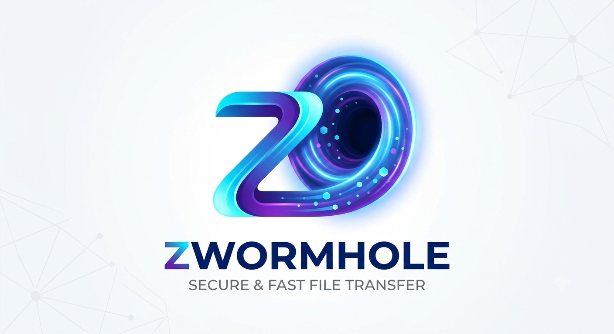
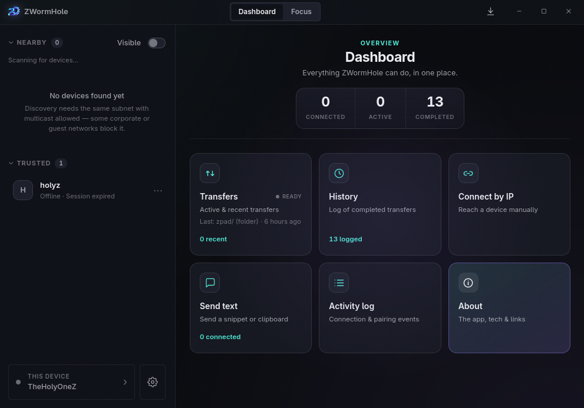
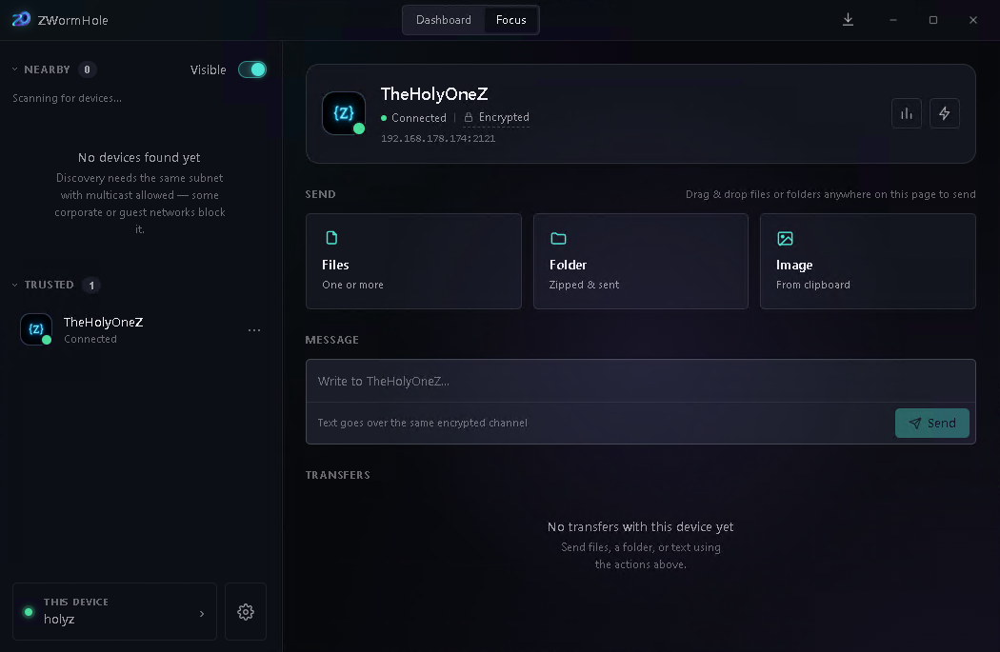
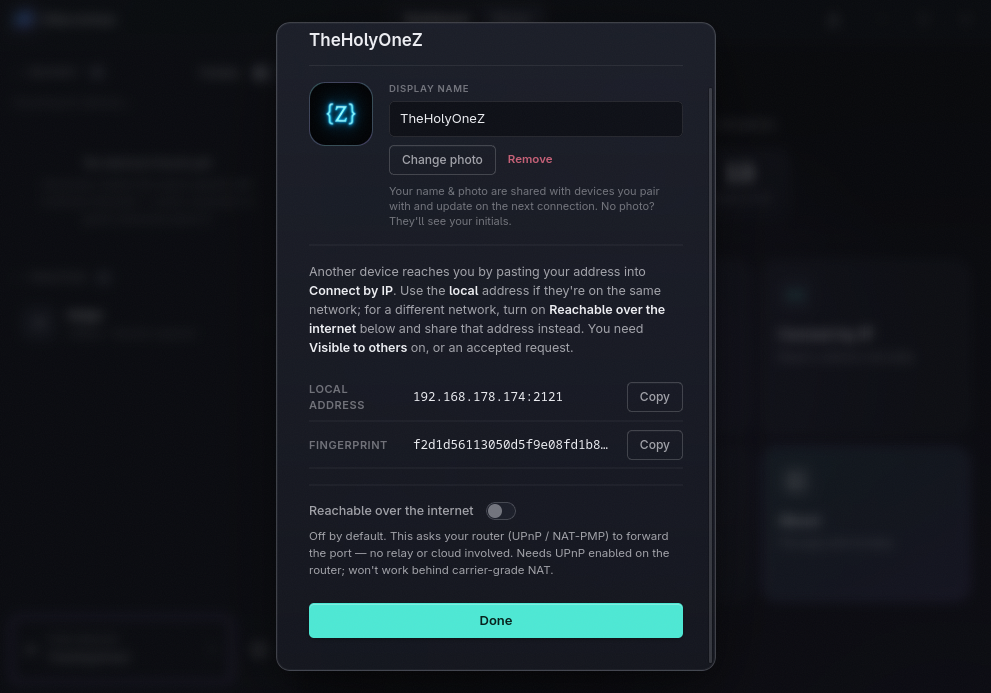

<div align="center">



**Send files, folders, images and text between your devices — instantly, privately, and with no cloud in the middle.**

Pair two devices with a short code, then move anything between them over a direct, end‑to‑end encrypted connection. No account, no relay server, no tracking.

<sub>Local‑first • End‑to‑end encrypted • No phone‑home</sub>

[Website](https://zsync.eu/zwormhole/) · [GitHub](https://github.com/TheHolyOneZ/ZWormHole) · Licensed under **GPL‑3.0**

</div>

---

## Table of contents

- [What is ZWormHole?](#what-is-zwormhole)
- [Screenshots](#screenshots)
- [Why ZWormHole?](#why-zwormhole)
- [Highlights](#highlights)
- [How it compares](#how-it-compares)
- [How it works](#how-it-works)
- [A tour of the app](#a-tour-of-the-app)
  - [The top bar](#the-top-bar)
  - [The sidebar](#the-sidebar)
  - [Dashboard](#dashboard)
  - [Focus mode](#focus-mode)
  - [The Downloads tray](#the-downloads-tray)
  - [This device & your profile](#this-device--your-profile)
  - [Settings](#settings)
  - [Prompts & pop‑ups](#prompts--pop-ups)
- [Security & privacy](#security--privacy)
- [Keyboard shortcuts](#keyboard-shortcuts)
- [Running from source](#running-from-source)
- [Tech stack](#tech-stack)
- [License](#license)

---

## What is ZWormHole?

ZWormHole is a desktop app for moving things between devices on your own terms. Two people (or two of your own machines) **pair once by confirming a short code**, and from then on they can send each other files, whole folders, clipboard images and text — directly, peer‑to‑peer.

Nothing you send ever passes through a company's servers. There is **no rendezvous server, no relay, no cloud storage, and no telemetry** — the app never contacts any outside service at all. Devices find each other on your local network automatically, and you can also connect across networks by IP.

---

## Screenshots

<p align="center">
  
  &nbsp;
  
</p>

<p align="center"><sub>The <b>Dashboard</b> (left) and <b>Focus mode</b> (right). A full walkthrough of every screen is in the <a href="#a-tour-of-the-app">tour below</a>.</sub></p>

---

## Why ZWormHole?

ZWormHole is for people who want:

- **Direct device‑to‑device transfers** — nothing sits in the middle.
- **No accounts** — nothing to sign up for or log into.
- **No cloud** — your files never land on someone else's server.
- **No relay servers** — even across the internet, it's still direct.
- **Persistent trusted devices** — pair once, reconnect automatically after.
- **Fast desktop workflows** — built for drag‑drop, keyboard, and getting out of your way.

If that's you, it's for you.

---

## Highlights

| | |
|---|---|
| 🔒 **End‑to‑end encrypted** | Everything is encrypted directly between the two devices. |
| 🛰️ **No cloud, no phone‑home** | Direct peer‑to‑peer. The app never talks to any server. |
| 🔍 **Finds devices automatically** | Nearby devices on your network just show up. |
| 🔑 **Simple code pairing** | Confirm one short code and you're connected. |
| 📁 **Files, folders, images & text** | Send almost anything, including whole folders and clipboard images. |
| 📤 **Send to several devices at once** | Fan a transfer out to multiple paired devices. |
| ▶️ **Resumes interrupted transfers** | A dropped connection picks up where it left off. |
| ⏳ **You choose how long to stay paired** | Remember a device for an hour, a day, or until you revoke it. |
| 📥 **Browser‑style Downloads tray** | Watch live download speed and re‑open recent files. |
| 🌐 **Optional internet reachability** | Reach a device across networks without any relay (asks your router directly). |
| 🖼️ **Device profiles** | Give your device a name and photo that friends see. |
| 🚫 **Block unwanted devices** | Permanently refuse a device you don't want. |
| ⚡ **Speed tools** | Test the link, benchmark it, and see exactly what's slowing a transfer. |

---

## How it compares

ZWormHole sits alongside excellent tools like [LocalSend](https://localsend.org/), [PairDrop](https://pairdrop.net/), [Warpinator](https://github.com/linuxmint/warpinator), [Magic Wormhole](https://magic-wormhole.readthedocs.io/) and [croc](https://github.com/schollz/croc). Here's an honest side‑by‑side — including where ZWormHole *doesn't* (yet) lead.

<sub>✅ full · ➖ partial / limited · ❌ no · — not applicable</sub>

| Feature | **ZWormHole** | LocalSend | PairDrop | Warpinator | Magic&nbsp;Wormhole | croc |
|---|:--:|:--:|:--:|:--:|:--:|:--:|
| Graphical app (no command line) | ✅ | ✅ | ✅ | ✅ | ❌ | ❌ |
| End‑to‑end encrypted&nbsp;<sup>†</sup> | ✅ | ✅ | ✅ | ✅ | ✅ | ✅ |
| Code‑confirmed pairing | ✅ | ➖ | ➖ | ❌ | ✅ | ✅ |
| Local‑network transfer | ✅ | ✅ | ✅ | ✅ | ✅ | ✅ |
| Internet transfer (across networks) | ✅ | ❌ | ✅ | ❌ | ✅ | ✅ |
| …with **no** relay or cloud server | ✅ | — | ❌ | — | ❌ | ❌ |
| Files & folders | ✅ | ✅ | ➖ | ✅ | ✅ | ✅ |
| Pick individual files from a folder | ✅ | ❌ | ❌ | ❌ | ❌ | ❌ |
| Text snippets | ✅ | ✅ | ✅ | ❌ | ✅ | ✅ |
| Clipboard image | ✅ | ❌ | ➖ | ❌ | ❌ | ❌ |
| Send to several devices at once | ✅ | ❌ | ❌ | ❌ | ❌ | ❌ |
| Resume interrupted transfers | ✅ | ❌ | ❌ | ❌ | ❌ | ✅ |
| Bandwidth / speed limit | ✅ | ❌ | ❌ | ❌ | ❌ | ❌ |
| Speed test & benchmark | ✅ | ❌ | ❌ | ❌ | ❌ | ❌ |
| "Why is it slow?" diagnosis | ✅ | ❌ | ❌ | ❌ | ❌ | ❌ |
| Live speed graphs | ✅ | ❌ | ❌ | ❌ | ❌ | ❌ |
| Device profiles (name + avatar) | ✅ | ➖ | ❌ | ❌ | ❌ | ❌ |
| Remembered trusted devices | ✅ | ✅ | ✅ | ➖ | ❌ | ❌ |
| Block a device | ✅ | ➖ | ❌ | ❌ | ❌ | ❌ |
| Open source | ✅ | ✅ | ✅ | ✅ | ✅ | ✅ |
| Desktop (Windows / macOS / Linux) | ✅ | ✅ | ✅ | ✅ | ✅ | ✅ |
| Mobile (iOS / Android) | ❌ | ✅ | ✅ | ➖ | ➖ | ➖ |

**What makes ZWormHole stand out:** it's the only one here that reaches a device **across the internet without any relay or cloud server** (it asks your own router to open the path — UPnP/NAT‑PMP), and it's uniquely built for **power users** — fan‑out to several devices at once, live speed graphs, a real benchmark, bandwidth caps, and a plain‑English "what's slowing this transfer" diagnosis.

**Where it's honestly behind:** there's **no mobile app** yet (LocalSend, PairDrop and Warpinator have one), and its serverless internet mode depends on your router supporting UPnP/NAT‑PMP. It's a desktop‑first tool.

> <sup>†</sup> **On "end‑to‑end encrypted":** every tool here encrypts data in transit, so the ✅ is fair across the board — but the *model* differs. ZWormHole ties its encryption to a **confirmed, persistent device identity**: a password‑authenticated handshake (SPAKE2) over the Noise protocol means you're provably talking to the exact device you paired with, and it's recognized again on reconnect. The code‑based tools (Magic Wormhole, croc) also authenticate with a one‑time code, but keep no lasting identity. LocalSend and PairDrop encrypt the connection (TLS / WebRTC) but don't pin a long‑term device identity in the same way.

<sub>Comparison compiled from each project's public docs and repositories (July 2026); other tools evolve quickly — spot something out of date? Please open an issue.</sub>

---

## How it works

1. **Both devices become visible** on the local network (this is automatic).
2. On one device you **pick a nearby device and connect** — or type its IP address.
3. Both screens show a **short confirmation code**. Check they match, confirm, and you're paired.
4. Now just **send** — drop files onto the device, pick a folder, paste an image, or type a message.
5. The next time those two devices meet, they **reconnect automatically** — no code needed again (for as long as the [trust duration](#trust-duration) you picked).

Behind the scenes every connection is authenticated and encrypted before a single byte of your data moves. The confirmation code is what proves you're connecting to the right device and not an impostor.

---

## A tour of the app

The window has three main regions: a **top bar**, a **sidebar** of devices on the left, and a large **main area** that shows either the Dashboard or Focus mode.

### The top bar

| Element | What it does |
|---|---|
| **Dashboard / Focus toggle** | Switches the main area between the multi‑device **Dashboard** and the single‑device **Focus** workspace. |
| **Downloads button** (↓) | Opens the [Downloads tray](#the-downloads-tray) — your incoming files, live and recent. A badge shows how many are arriving right now. |
| **Window controls** | Minimize, maximize, and close. |

### The sidebar

The sidebar lists the devices you can reach and is where connecting happens.

- **Nearby** — devices discovered on your local network. Click **Connect** to start pairing. A **Visible** switch here controls whether other people can discover *you*, and a **Trust for** selector lets you choose how long a new pairing is remembered (see [Trust duration](#trust-duration)). Devices that go offline disappear on their own, and you never see yourself or a device you've blocked. Right‑click a nearby device to see its details (OS, addresses, port, fingerprint, protocol version).
- **Trusted devices** — everything you've paired with before. A green dot means it's currently connected. Click a connected device to open it in [Focus mode](#focus-mode). Once you have several, a **search box** and **All / Connected / Favorites** filters appear. When **two or more** devices are connected, a **Send to multiple** bar appears so you can fan one transfer out to several of them at once.
- **This device** (bottom of the sidebar) — shows your device name and whether you're currently visible; click it to open your connection details and [profile](#this-device--your-profile).
- **Settings** — opens the [Settings](#settings) panel.

You can **collapse the Nearby or Trusted sections** by clicking their headers to tidy up the sidebar.

#### Trust duration

When you start a pairing (from Nearby or Connect by IP) you pick how long it should be remembered: **1 hour**, **4 hours**, **24 hours**, **Never** (never expires — stays trusted until you revoke it), or a **custom** number of hours. Within that window the two devices reconnect automatically with no code; once it lapses, you simply confirm a code again. The default is 4 hours.

**Right‑click any trusted device** (or use its ⋯ menu) for its full set of actions:

| Action | What it does |
|---|---|
| **Send files / Send folder / Send clipboard image** | Send straight to that device (when connected). |
| **Test connection** | A quick speed check of the live link. |
| **Benchmark** | A thorough two‑way throughput test — pick the size (256 MB to 10 GB), compare against that device's **recent runs**, and export the result as JSON. |
| **Auto‑accept** | Let this one device send you files without asking each time. |
| **Rename** | Give the device your own nickname. |
| **Add to favorites** | Pin it to the top of the list. |
| **Revoke** | Forget the device (you can always pair again). |
| **Block** | Forget it **and** permanently refuse any future connection from it. |

### Dashboard

The Dashboard is your overview of everything the app can do. At the top are three **live stat cards** you can click:

| Stat card | Click it to… |
|---|---|
| **Connected** | Jump into the connected device (Focus mode). |
| **Active** | Open the Transfers view. |
| **Completed** | Open your History. |

Below them is a grid of feature cards:

| Card | What it's for |
|---|---|
| **Transfers** | Everything currently sending or recently sent. Shows the last transfer, a live status (Ready / Active / Waiting / Error), and per‑transfer progress, speed, a live **time‑remaining** estimate, and controls (pause, resume, cancel — also available on right‑click). If a transfer was cut off by a dropped connection, it shows up here to **resume**. Click a transfer for a detailed view with a **speed‑over‑time graph** and a plain‑English explanation of what's limiting it (your disk, your CPU, the network, or the other device). |
| **History** | A searchable log of completed transfers. Filter by direction (sent/received) or time, **export to CSV** or **clear** the whole log, and for received files **Open** them or **Show in folder**. If a device is connected you can **re‑send** something with one click. |
| **Connect by IP** | Pair with a device by typing its address — for networks that block automatic discovery, or to reach a device on another network. You pick a [trust duration](#trust-duration), and it also shows **your** address to share so others can reach you. |
| **Send text** | Send a text snippet to a chosen connected device — with a **Paste** button to pull in your clipboard text and a **Send image** button for a clipboard image. |
| **Activity log** | A running log of connection, pairing and transfer events for the current session. |
| **About** | App info, the technology it uses, and project links. |

### Focus mode

Focus mode is the fastest way to work with **one** connected device. Everything on the page is scoped to that single device.

- **Identity card** — the device's avatar and name, a **Connected** indicator, and an **Encrypted** badge you can hover to see exactly how the connection is secured. It also shows the **address you're connected on** (click to copy), and buttons to **benchmark** or **speed‑test** the link. If several devices are connected, a switcher lets you flip between them.
- **Send** — one‑click **Files**, **Folder**, or **Clipboard image**. Sending a **folder** opens a checkbox tree where you can **pick exactly which files to include** (with select‑all / expand‑all and a running "N of M files · size" total) before it's zipped and sent. You can also **drag & drop files or folders anywhere on the page** to send them.
- **Message** — a composer for sending text over the same encrypted channel (⌘/Ctrl + Enter to send).
- **Transfers** — a live feed of just this device's transfers, so you stay in Focus while things send.

### The Downloads tray

Opened from the ↓ button in the top bar — this is your "what am I receiving?" panel, like a browser's downloads popup.

- **Receiving now** — each incoming transfer with a **live speed graph**, a progress bar, percentage, and current rate.
- **Recent** — files you've received. Click one to expand its details: the **speed graph** from when it arrived, who it was from, the size, the exact time, and the full file list. **Open** or **Show in folder** are right there.

### This device & your profile

<p align="center"></p>

Opening **This device** shows how others reach you, and lets you set up your profile.

| Section | What it does |
|---|---|
| **Your profile** | Set a **display name** and an **avatar photo**. These are shared with devices you pair with and update automatically the next time you connect. No photo? Others see your initials. |
| **Local address** | The address to share so someone on the **same network** can reach you via *Connect by IP*. |
| **Reachable over the internet** | Optionally ask your **router** (not any cloud service) to open a path so someone on **another network** can reach you. Fully serverless — it only talks to your gateway. Shows the address to share, and warns you if your connection can't support it. |
| **Fingerprint** | Your device's unique identity, which trusted devices recognize you by. |

### Settings

| Setting | What it does |
|---|---|
| **Auto‑accept from paired devices** | Receive files without a prompt. Off by default. |
| **Send speed limit** | Cap your upload speed so a transfer doesn't hog the connection. Applies live, even mid‑transfer. |
| **Max simultaneous sends** | Limit how many transfers run at once; the rest wait their turn. |
| **Save incoming files to** | Choose where received files land (defaults to Downloads). |
| **Received folders** | For folder transfers (which arrive zipped): leave the `.zip`, or automatically extract it. Applied automatically when auto‑accept is on. |
| **Connection port** | Advanced: pin a fixed network port for firewall/port‑forward rules. Most people never need this — discovery works on any port. |
| **Run in background** | Keep receiving when the window is closed; a tray icon stays available. |
| **Trusted devices** | See who you've paired with (rename, favorite, revoke, or auto‑accept from the sidebar). |
| **Blocked devices** | See who you've blocked, and unblock them if you change your mind. |

### Prompts & pop‑ups

| Prompt | When it appears |
|---|---|
| **Pairing request** | Someone wants to connect. Confirm the code matches theirs — or **Block** them. Multiple requests queue up so no one is missed. |
| **Incoming transfer** | Someone's sending you files. See exactly what's coming (names, sizes, types), choose where to save, and for folders decide whether to extract — then **Accept** or **Decline**. |
| **Message received** | A text message arrives with the sender's name and avatar, and a **Copy** button. |
| **Benchmark / Connection test** | Consent prompts before another device runs a bandwidth test against you — with an option to **always allow** that trusted device so it won't ask again. |
| **Toasts** | Small in‑app confirmations (e.g. "Received 3 files") — some carry an **Open folder** shortcut. |
| **Desktop notifications** | A system notification when files, a message, or a pairing request arrive — so you're alerted even when the app is in the background. |

---

## Security & privacy

- **End‑to‑end encrypted.** Every connection is authenticated and encrypted directly between the two devices, using a modern Noise handshake over QUIC (X25519 key exchange, ChaCha20‑Poly1305 encryption, BLAKE2s/BLAKE3 hashing). Data is verified for integrity per‑chunk and per‑file.
- **Code‑confirmed pairing.** Pairing uses a password‑authenticated exchange (SPAKE2): confirming the short code is what proves you're talking to the right device.
- **Direct, peer‑to‑peer.** Your data travels straight between the two devices — never through a relay or cloud.
- **No phone‑home.** The app contacts **no** external servers: no rendezvous, no STUN, no telemetry, no in‑app updates. Internet reachability is done by asking your **own router**, on your LAN.
- **You're always in control.** Nothing lands on your disk until you accept it (unless you explicitly turn on auto‑accept), and you can revoke or block any device at any time.

---

## Keyboard shortcuts

| Shortcut | Action |
|---|---|
| <kbd>Ctrl/⌘</kbd> + <kbd>1</kbd> | Switch to Dashboard |
| <kbd>Ctrl/⌘</kbd> + <kbd>2</kbd> | Switch to Focus |
| <kbd>Ctrl/⌘</kbd> + <kbd>,</kbd> | Open Settings |
| <kbd>⌘/Ctrl</kbd> + <kbd>Enter</kbd> | Send a message (in the composer) |
| <kbd>Esc</kbd> | Close the frontmost dismissible pop‑up (decision prompts like pairing still need an explicit choice) |

---

## Running from source

ZWormHole is a [Tauri](https://tauri.app) app (Rust backend + web frontend).

**Prerequisites:** [Node.js](https://nodejs.org) + a package manager (e.g. `pnpm`), the [Rust toolchain](https://rustup.rs), and Tauri's [system dependencies](https://tauri.app/start/prerequisites/) for your OS.

```bash
# install frontend dependencies
pnpm install

# run the app in development
pnpm tauri dev

# build a distributable app
pnpm tauri build
```

---

## Tech stack

- **[Tauri](https://tauri.app)** — desktop shell (Rust core, web UI)
- **React** — user interface
- **QUIC** (via [quinn](https://github.com/quinn-rs/quinn)) — fast, modern transport
- **Noise Protocol** (via [snow](https://github.com/mcginty/snow)) — end‑to‑end encryption over QUIC
- **SPAKE2** — code‑based pairing
- **mDNS** — automatic local‑network discovery
- **UPnP / NAT‑PMP** — optional, serverless internet reachability

---

## License

Released under the **[GPL‑3.0](LICENSE)** license.

© 2026 **TheHolyOneZ** · [zsync.eu](https://zsync.eu/) · [github.com/TheHolyOneZ](https://github.com/TheHolyOneZ)
